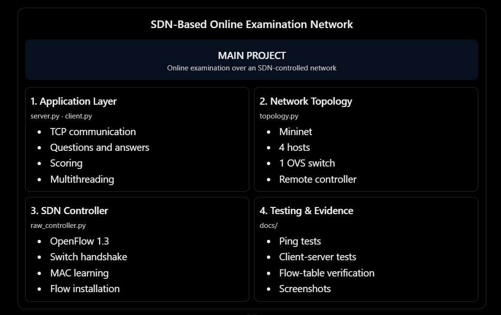

# SDN-Based Online Examination Network

## 1. Project Overview

This project implements an SDN-controlled online examination network using TCP socket programming, Mininet and OpenFlow 1.3.

The system consists of a central examination server and multiple student clients connected through an Open vSwitch controlled by a custom SDN controller.

Students connect to the examination server, receive multiple-choice questions, submit their answers and receive their scores.

The D2 implementation extends the system with administrator-controlled dynamic SDN policies that can selectively block and restore student connectivity.

## D1 — Project Overview

The following mind map provides an overview of the major components implemented as part of Deliverable 1.



## 2. Objectives

- Implement reliable client-server communication using TCP sockets.
- Build and simulate a network topology using Mininet.
- Implement a custom SDN controller supporting OpenFlow 1.3.
- Demonstrate dynamic MAC address learning and flow-rule installation.
- Support multiple concurrent examination clients.
- Implement administrator-controlled dynamic network access policies.
- Evaluate network performance under normal and restricted conditions.

## 3. System Architecture

| Component | IP Address | Role |
|---|---|---|
| h1 | 10.0.0.1 | Examination server |
| h2 | 10.0.0.2 | Student client 1 |
| h3 | 10.0.0.3 | Student client 2 |
| h4 | 10.0.0.4 | Student client 3 |
| s1 | — | OpenFlow 1.3 switch |
| c0 | 127.0.0.1:6653 | SDN controller connection |

All four hosts connect to a single Open vSwitch. The switch communicates with the custom SDN controller over OpenFlow 1.3.

The controller also exposes an administrator policy interface on `127.0.0.1:6654`.

See [Network Architecture](docs/architecture.md) for the detailed architecture and workflows.

## 4. Technologies Used

- Python 3
- TCP Socket Programming
- Mininet
- Open vSwitch
- OpenFlow 1.3
- Ubuntu Linux
- iperf

## 5. Project Files

| File | Description |
|---|---|
| `topology.py` | Creates and starts the Mininet network topology |
| `raw_controller.py` | Custom OpenFlow 1.3 controller with MAC learning and dynamic policies |
| `server.py` | Multithreaded TCP examination server |
| `client.py` | Student examination client |
| `admin.py` | Sends administrator BLOCK and UNBLOCK requests |
| `concurrent_test.py` | Tests examination sessions from multiple student hosts |
| `docs/architecture.md` | Network architecture and D2 policy workflow |
| `docs/test-results.md` | D1 and D2 test results |

## 6. Environment Setup

### System Requirements

- Ubuntu Linux or a compatible Ubuntu environment
- Python 3
- Mininet
- Open vSwitch
- iperf

### Install system dependencies

```bash
sudo apt update
sudo apt install mininet openvswitch-switch python3 python3-venv iperf
