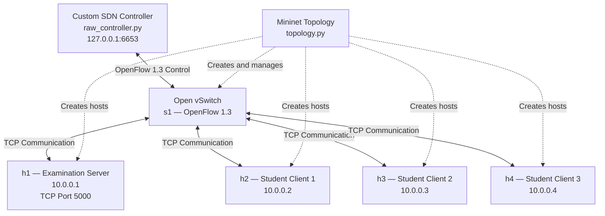

# Network Architecture

## SDN-Based Online Examination Network

The network consists of four Mininet hosts connected through a single OpenFlow 1.3 switch. The custom SDN controller manages the switch using the OpenFlow control channel.

## Component Responsibilities

| Component | Responsibility |
|---|---|
| SDN Controller | Learns MAC addresses and installs forwarding rules |
| Open vSwitch | Forwards packets based on installed flow rules |
| Examination Server | Accepts TCP connections, sends questions and evaluates answers |
| Student Clients | Connect to the server and submit examination answers |
| Mininet | Creates the virtual network topology |

## Communication Workflow

1. The SDN controller establishes an OpenFlow 1.3 connection with the switch.
2. Student clients initiate TCP connections to the examination server at `10.0.0.1:5000`.
3. The switch forwards unknown-destination packets to the controller.
4. The controller learns source MAC addresses and installs forwarding rules for known destinations.
5. The server handles client sessions using multithreading and returns examination results.
