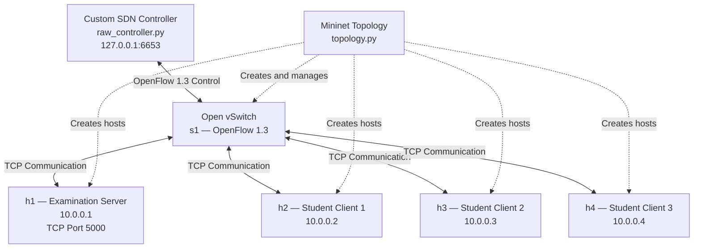

# Network Architecture

## SDN-Based Online Examination Network

The network consists of four Mininet hosts connected through a single OpenFlow 1.3 switch. The custom SDN controller manages the switch using the OpenFlow control channel.

## Component Responsibilities

| Component | Responsibility |
|---|---|
| SDN Controller | Learns MAC addresses and installs forwarding rules |
| Open vSwitch | Forwards packets based on installed flow rules |
| Examination Server | Accepts TCP connections, sends questions and evaluates answers |
| Student Clients | Connect to the server and submit examination answers |
| Mininet | Creates the virtual network topology |

## Communication Workflow

1. The SDN controller establishes an OpenFlow 1.3 connection with the switch.
2. Student clients initiate TCP connections to the examination server at `10.0.0.1:5000`.
3. The switch forwards unknown-destination packets to the controller.
4. The controller learns source MAC addresses and installs forwarding rules for known destinations.
5. The server handles client sessions using multithreading and returns examination results.

## D2 — Dynamic SDN Policy Management

D2 extends the controller with an administrator policy interface. The administrator can dynamically block or unblock a student using the `admin.py` command-line utility.

### Additional Components

| Component | Responsibility |
|---|---|
| Admin Utility (`admin.py`) | Sends BLOCK and UNBLOCK requests to the controller |
| Admin Policy Interface | Listens for policy requests on `127.0.0.1:6654` |
| Dynamic Flow Rules | Enforce student-specific traffic restrictions at the switch |

### Dynamic Policy Workflow

1. The administrator executes `admin.py` with a BLOCK or UNBLOCK command and a student IP address.
2. The utility sends a JSON request to the controller's policy interface on port 6654.
3. The controller validates the request and identifies the connected switch.
4. For BLOCK, the controller installs an OpenFlow 1.3 rule matching the student's source IP and the examination server's destination IP.
5. The rule uses priority 200 and a DROP action, preventing the selected student from reaching the examination server.
6. For UNBLOCK, the controller deletes the corresponding policy rule, restoring connectivity.
7. Other students remain unaffected by the selected student's blocking rule.

### Dynamic Policy Rule

The blocking rule matches:
- Ethernet type: IPv4
- Source IP: Student IP address
- Destination IP: 10.0.0.1
- Priority: 200
- Action: DROP

The rule is installed dynamically without restarting the controller or Mininet topology.

### Policy Commands

- `python3 admin.py BLOCK 10.0.0.2`
- `python3 admin.py UNBLOCK 10.0.0.2`

The administrator utility runs from the project environment, while the controller applies the policy directly to the Open vSwitch instance.
